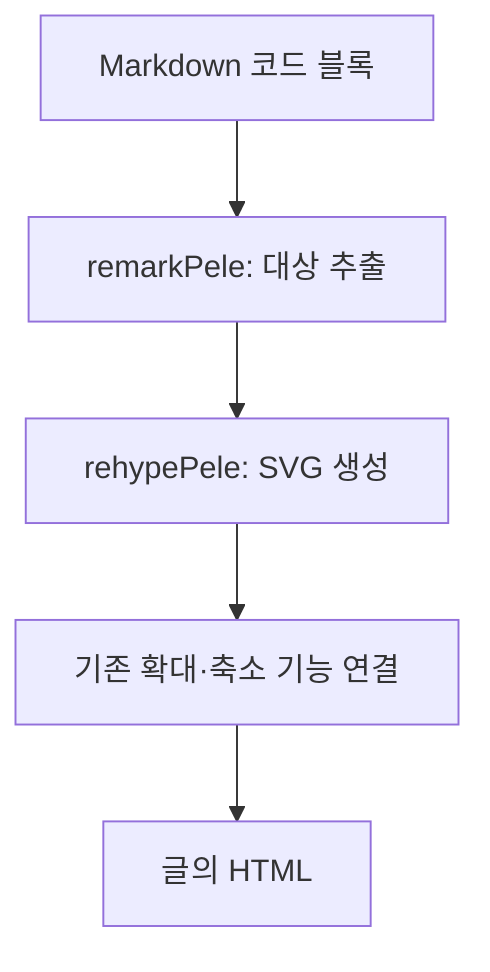

## 시발점

이제 막 블로그를 꾸미고 있다. Firefly 템플릿을 적용하고 설정과 코드를 하나씩 살펴보다가, 글에 Mermaid 다이어그램을 넣을 수 있다는 걸 발견했다.

그러자 전에 옵시디언 쪽에서 봤던 [Pele](https://github.com/obsidianmd/pele)가 떠올랐다. 

아직 글도 별로 없는데 렌더러부터 바꿀 필요가 있나 싶었지만, 블로그를 손보는 김에 붙여보고 싶었다.

처음에는 Mermaid.js를 교체하면 될 줄 알았다. 그런데 코드를 열어보니 이 블로그 템플릿은 이미 Merman으로 빌드할 때 SVG를 만들고 있었다.

이미 충분히 빠르겠지만, 그냥 생각한 거 바꾸기로 했다.

## Pele는 무엇인가

<figure style="max-width: 20rem; margin: 2rem auto; padding: 1.5rem; border: 1px solid var(--line-divider); border-radius: 1rem; background: var(--btn-regular-bg); text-align: center;">
  
  <figcaption style="margin: 1rem 0 0; font-size: 0.875rem; color: var(--content-meta);">
    <a href="https://pele.run/">Pele 공식 아이콘</a>
  </figcaption>
</figure>

Pele는 Mermaid 문법을 읽어 SVG를 만드는 렌더러다.

이름은 화산과 불의 여신 펠레에서 따왔다고 한다.
맨 처음 봤을 때, 화산 같기도 사람의 옆모습 같기도 했던 아이콘이 정말 이중적 의미를 담고 있었을 줄은 몰랐다.

아이콘 이쁘지 않나. 되게 잘 만든 아이콘 같은데.

[공식 홈페이지](https://pele.run/#why-pele)는 Pele의 장점을 다음과 같이 소개한다. 아래 수치는 Pele에서 주장하는 **Pele와 Mermaid.js의 공식 비교**다.

| 항목 | Pele | Mermaid.js |
| --- | --- | --- |
| gzip 압축 번들 크기 | 230 kB | 1.6 MB |
| 렌더링 시간 | 0.05–0.3 ms | 6–82 ms |
| 직접 의존성 수 | 0 | 23 |
| 테마 설정 | CSS 변수 | 테마 설정 객체 |

공식 소개의 표현으로는 최대 500배 빠르다고 한다.

뭐 자기네들 기술이 제일 좋다고 하겠으니 저렇게 극단적인 수치가 아닐 수도 있지만, 빠른 건 확실하겠지.

## Astro에 Pele 연결하기

블로그 템플릿에서 제공하는 기존 구조를 유지하면서 다이어그램을 만드는 부분만 바꿨다.

적용한 Pele 버전은 `1.8.0`이다.

먼저 Pele 자체의 사용법은 짧다. `render()`에 Mermaid 문법을 전달하면 SVG 문자열을 받을 수 있다. 다음 코드는 Pele가 설치된 프로젝트에서 `.mjs` 파일로 실행할 수 있다.

```mjs title="pele 사용법.mjs"
import { render } from "pele";

const source = `flowchart LR
    A[가] --> B[나] --> C[다]`;

const { svg } = render(source, {
	idPrefix: "example-0",
	fontFamily: "system-ui, sans-serif",
	autoDirection: false,
});

console.log(svg);
```

```pele
flowchart LR
	A[가] --> B[나]
	B[나] --> C[다]
```

### 구조

정적 블로그를 직접 만들어 본 사람들은 알겠지만, `remark-*`, `rehype-*`라는 라이브러리를 매우 많이 볼 수 있다.

특히 Markdown으로 작성한 글을 HTML로 변환하는 빌드 파이프라인에 이러한 플러그인을 추가하는 경우가 많다.

- **remark**: Markdown을 HTML로 변환하기 전 단계에서 동작한다. 제목, 문단, 링크, 코드 블록 등 Markdown의 구조를 분석하고, 플러그인을 통해 문법을 확장하거나 콘텐츠를 가공할 수 있다.
- **rehype**: Markdown이 HTML 구조로 변환된 이후 단계에서 동작한다. HTML 요소에 속성을 추가하거나, 코드 구문 강조를 적용하고, 생성될 HTML의 구조를 변경하는 등의 작업을 담당한다.

그리고 내가 할 일은 원래 동작하는 렌더러만 바꾸는 작업이었다.

따라서, 이 블로그에서는 작성할 코드는 생각보다 적었다. 거의 이름만 바꾸는 수준의 작업 말고는 없었으니까.

아래 다이어그램은 pele로 렌더링된 다이어그램이다.



이런식으로 구성되므로 내가 할 일은 rehype에서 렌더러를 수정하는 것만 진행하면 됐다.

## 가장 마음에 든 변화

바꾸고 보니 의미없는 변경은 아니었다.

이전과 다른 점이 분명히 생겼는데 무려 css로 색상을 관리할 수 있게 됐다.

...

사실 theme 기능을 merman에서도 지원은 하고 있었다. 그게 조금 귀찮게 생겼을 뿐이지.

아무튼 좋은게 좋은 거니까.

배경과 노드 색상은 블로그가 이미 쓰는 변수에 연결해서 통일성을 유지하기 쉬워졌다.

## 꼭 바꿔야 했을까

사실 꼭 필요한 작업은 아니었다.

이미 Merman으로 빌드할 때 SVG를 만들고 있었고, 블로그에 성능 문제를 느낄 만큼 다이어그램이 많은 것도 아니었다.

속도 때문에 바꿔야 할 이유도 없었고.

이제 블로그 꾸미는 것도, 이쯤 손봤으니 여기에 넣을 글이나 써야겠다.

이래놓고 또 꾸미러 갈 수도 있겠지만.
